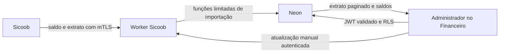

# Integração Sicoob — Magalhães Advocacia

Implementação em 17/11/2026. Escopo: saldo, extrato da conta corrente e conciliação com baixas já registradas no financeiro.

## Componentes

| Camada | Implementação |
| --- | --- |
| GitHub Pages | Interface em `Financeiro → Sicoob`, publicada pelo workflow `pages.yml` a partir de `main` |
| Neon | PostgreSQL, Neon Auth, Data API e RLS do projeto exclusivo `magalhaes-advocacia` |
| Cloudflare | Worker exclusivo `magalhaes-sicoob`, independente do conector `taskflow-mcp` |
| Sicoob | API Conta Corrente v4; OAuth client credentials e certificado mTLS |

Site: <https://ragcode-br.github.io/magalhaes-advocacia/financeiro>.
Serviço: <https://magalhaes-sicoob.ragcodebr.workers.dev>.

## Funcionamento entregue

- A conta corrente autorizada pelo banco é vinculada à conta financeira **Sicoob · Conta corrente**. O saldo inicial foi obtido de `saldoAnterior` do extrato de novembro, com data de abertura em 01/11/2026. Isso não cria baixas de honorários ou despesas.
- O Worker consulta o mês corrente a cada 30 minutos, pelo calendário de São Paulo. O botão **Atualizar extrato** consulta o mês escolhido. Meses anteriores dependem da disponibilidade do histórico na API do banco.
- A API utilizada retorna o mês em uma resposta, com `transactionId` estável. O importador rejeita resposta incompleta, identificadores repetidos, valores ou datas inválidos; não inventa identificadores por data/valor. Valores iguais de pagamentos distintos continuam sendo movimentos distintos.
- Cada importação usa uma transação SQL e uma trava temporária por conexão. Repetir a consulta atualiza somente movimentos alterados; não duplica lançamentos. Falhas preservam os dados anteriores e aparecem na tela junto à última atualização concluída.
- O saldo atual informado pelo banco aparece separado das entradas e saídas do mês. Limite de crédito e bloqueios ficam registrados separadamente. O limite não é somado ao saldo.
- A lista consulta até 51 registros para apresentar páginas de 50, usando data/identificador como cursor. Totais mensais são calculados no servidor. Abrir a tela não dispara consultas no Sicoob por usuário.
- A conciliação é confirmada pelo administrador: uma movimentação é vinculada a uma baixa existente, da mesma conta, mesmo valor e direção. As sugestões são ordenadas pela proximidade da data. O vínculo não altera valor nem data da baixa.
- Desfazer uma conciliação exige motivo e mantém a baixa financeira. O histórico guarda a operação. Uma baixa conciliada não pode ser estornada sem desfazer o vínculo. Alteração posterior de valor/data pelo banco também exige revisão antes de sincronizar.
- Não foram habilitados pagamentos, transferências bancárias ou emissão de boletos. A permissão solicitada ao Sicoob é somente `cco_consulta openid`.

### Limites desta etapa

A conciliação é de uma movimentação para uma baixa de mesmo valor. Pagamentos agrupados, divisão entre várias baixas, taxas e estornos automáticos precisam de regras específicas. Movimentos de transferência entre contas também não recebem conciliação automática nesta entrega. O extrato não marca um honorário como recebido sozinho.

RDC ainda depende de uma API ou arquivo com posição e movimentos do investimento, distinguindo principal, rendimentos, impostos e taxas. A consulta de conta corrente não foi tratada como consulta completa do RDC.

## Segurança e operação

- Certificado e chave privada ficam no binding mTLS do Cloudflare. O certificado apresentado vence em **17/09/2027**; renovar no banco e substituir o binding antes desse prazo.
- `SICOOB_CLIENT_ID`, `SICOOB_ACCOUNT` e `BANK_DATABASE_URL` são segredos do Worker. A cópia de configuração local está em `.banking.local/secrets.json`, ignorada pelo Git e com permissões privadas. Nenhuma dessas credenciais é variável `VITE_`.
- A identidade PostgreSQL `magalhaes_sicoob` não tem permissões de tabela, administração ou identidade de usuário. Pode somente chamar as funções de aquisição/conclusão da sincronização. O importador não usa a credencial proprietária do banco.
- A interface e as funções de conciliação exigem administrador no servidor. A atualização manual valida o JWT pelo Neon Data API antes de acessar o Sicoob. CORS permite a origem do Pages; CORS sozinho não é usado como autenticação.
- Tokens bancários duram poucos minutos e são mantidos apenas em memória. Requisições têm timeout e não seguem redirecionamentos. Há pausa de 600 ms entre saldo e extrato para respeitar o limite de duas requisições por segundo da documentação.
- O cron não depende do computador do escritório ligado. O horário fixo é `*/30 * * * *`. A consulta manual tem intervalo mínimo de 30 segundos por conexão e trava expira em dois minutos em caso de interrupção.
- `/health` confirma somente que o Worker responde; não prova a conexão com o banco. Verificar `last_success_at`, `last_error` e as execuções agendadas para avaliar a operação.

### Publicação e manutenção

1. As migrações `20261116120000_bank_statement_foundation.sql` e `20261117120000_sicoob_connector.sql` devem existir no banco. Foram aplicadas ao Neon da Magalhães nesta implantação.
2. O código do serviço fica em `mcp/banking`. Publicar a partir de `mcp` com `./node_modules/.bin/wrangler deploy --config banking/wrangler.toml`. Os segredos existentes são preservados. Para uma instalação nova, provisionar a identidade limitada, conexão e segredos antes de habilitar o cron.
3. O frontend segue o workflow normal do repositório: testes, `npm run build:pages`, push autorizado para `main`, verificação do workflow e do endereço público.
4. Não copiar os arquivos privados, PFX, PEM ou chave privada para o GitHub Pages. O certificado mTLS é configurado por ID no Wrangler; sua chave não é parte do bundle.
5. Não substituir o banco da consultoria nem o Worker MCP para ajustar esta integração.

## Capacidade e consumo

A inspeção de 16/11/2026 encontrou aproximadamente 715 MB no banco, dos quais 696 MB (97,4%) eram anexos em `storage.objects`. A transferência acumulada informada pelo Neon naquele momento era 1,45 GB; o plano da organização era Build. Esses números são uma fotografia anterior, não medição contínua nem garantia de franquia.

Em PostgreSQL descartável, 100.003 movimentos fictícios e seus índices ocuparam aproximadamente 41 MB, com consulta por conta/data usando índice. O volume do extrato é muito menor que o dos documentos. Não foi executado teste de carga de usuários em produção.

A sincronização é centralizada: no máximo 48 execuções agendadas por dia, mais atualizações manuais, cada uma consultando saldo e extrato mensal. O frontend recebe somente páginas do Neon. O consumo cresce com o extrato mensal e a frequência; acompanhar métricas do Cloudflare/Neon. Não foi contratado upgrade de infraestrutura nesta entrega.

O fluxo de anexos atual continua no PostgreSQL e pode consumir muito mais transferência que esta integração. Migrar esses arquivos para armazenamento privado de objetos é uma entrega separada.

## Validação

- Testes de aplicação e build do Pages.
- Testes do adaptador: centavos exatos, datas, IDs bancários, respostas inválidas, separação entre saldo/limite e rejeição de redirecionamento.
- PostgreSQL descartável: importação repetida, paginação, permissões, concorrência de conciliações, valores/tipos incompatíveis, desfazimento com motivo, preservação de dados em falha e bloqueio de alteração de baixa conciliada.
- Compilação TypeScript do Worker. A checagem global do aplicativo ainda possui 23 diagnósticos preexistentes em outros módulos.
- Autenticação real do certificado e consulta de saldo/extrato da conta autorizada: 13 movimentações em novembro até a primeira consulta, sem registrar baixas financeiras de teste em produção.

## Fontes técnicas

- [Sicoob — Conta Corrente](https://developers.sicoob.com.br/portal/documentacao?slugItem=apis&slugSubItem=conta-corrente)
- [Sicoob — autenticação](https://developers.sicoob.com.br/portal/documentacao?slugItem=seguranca&slugSubItem=autenticacao)
- [Sicoob — certificado digital](https://developers.sicoob.com.br/portal/documentacao?slugItem=seguranca&slugSubItem=certificado-digital)
- [Cloudflare — mTLS](https://developers.cloudflare.com/workers/runtime-apis/bindings/mtls/)
- [Cloudflare — agendamentos](https://developers.cloudflare.com/workers/configuration/cron-triggers/)
- [Cloudflare — limites](https://developers.cloudflare.com/workers/platform/limits/)
- [Neon — acompanhamento de consumo](https://neon.com/docs/introduction/monitor-usage)
