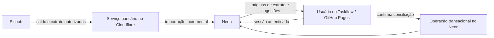

# Integração Sicoob — Magalhães Advocacia

Verificação em 16/11/2026. Objetivo inicial: saldo, recebimentos e conciliação bancária. RDC depende da disponibilidade dos dados do investimento para a conta do escritório.

## Estrutura conferida

| Camada | Estado observado | Papel na integração |
| --- | --- | --- |
| GitHub Pages | Publicação por `.github/workflows/pages.yml`, build de `main`, último workflow com sucesso em 11/11/2026 no commit `c8fcc00` | Entregar a interface e consultar dados autorizados |
| Neon | PostgreSQL, Neon Auth, Data API e RLS. Projeto `magalhaes-advocacia`, plano da organização retornado pela API como `build` | Guardar extratos, saldos, vínculos de conciliação e histórico |
| Cloudflare | Worker `taskflow-mcp`, publicado na conta RAG, endpoint respondendo HTTP 200. Código em `mcp/worker.ts` | O Worker existente atende ao conector MCP. Um serviço bancário precisa ser implementado e implantado |
| Financeiro | Contas, lançamentos, baixas, transferências, contratos e relatórios internos | Receber vínculos com as movimentações bancárias |

O site principal é `https://ragcode-br.github.io/magalhaes-advocacia/`. O endereço público funciona como entrada do sistema, com autenticação e autorização no acesso aos dados. GitHub Pages hospeda arquivos estáticos. As credenciais do Sicoob precisam ficar no serviço de integração.

## Capacidade observada

Consulta de produção executada em transação somente de leitura, com o destino validado por `scripts/neon-db.mjs`. A inspeção usou tamanhos e contagens, sem baixar o conteúdo dos anexos.

| Medida | Valor observado |
| --- | --- |
| Tamanho físico do banco atual | 714.694.656 bytes, aproximadamente 715 MB |
| Tabela `storage.objects`, incluindo índices e armazenamento associado | 696.279.040 bytes, aproximadamente 696 MB e 97,4% do banco |
| Quantidade estimada de objetos em estatísticas PostgreSQL | 514 |
| Transferência do projeto no ciclo atual, segundo a API Neon | 1.452.802.093 bytes, aproximadamente 1,45 GB |
| Ciclo informado pela API | 06/11/2026 11:14 UTC até 01/12/2026 00:00 UTC |
| Plano informado pela API da organização | Build |

Esses números mostram espaço consumido e uso acumulado do projeto. A franquia contratada exata do Build, eventual consumo de outros projetos, cobrança e limites do Worker precisam ser conferidos no painel da respectiva conta. A API consultada não retornou as franquias do plano. O catálogo público atual do Neon não apresenta o mesmo nome Build, portanto seus preços não foram usados como prova dos limites desta assinatura.

O banco respondeu às consultas. Esta avaliação não executou um teste de carga em produção e não determina a capacidade máxima de usuários simultâneos.

### Ensaio local

Uma instância PostgreSQL descartável recebeu 100.003 linhas fictícias na nova tabela de extratos. A tabela e seus índices ocuparam 40.820.736 bytes, aproximadamente 41 MB. A consulta de 100 movimentações por conta e mês usou o índice `office_bank_transactions_period`.

A medição serve para estimar o armazenamento dessa estrutura. Latência de rede, RLS real, carga compartilhada, réplicas/histórico e características do plano Neon não foram simulados. O tamanho real varia com os dados recebidos.

## Fluxo proposto

1. O serviço consulta o Sicoob em intervalos permitidos pela API. Uma frequência inicial de 15–30 minutos em horário de trabalho é uma proposta a validar com a equipe e o banco.
2. Uma execução por conta busca as páginas do período ainda pendente e uma pequena janela anterior para identificar lançamentos recebidos com atraso. O último ponto concluído avança somente depois de persistir todas as páginas.
3. Cada transação usa o identificador estável do banco e a conexão de origem para evitar repetição. Data e valor iguais podem representar pagamentos distintos. Caso a API não forneça esse identificador, a estratégia de identificação precisa ser validada com exemplos antes da importação real.
4. Alterações de um lançamento já importado devem ser detectadas. Uma correção posterior do banco precisa de histórico e revisão da conciliação existente.
5. O aplicativo lê os registros já sincronizados por conta e período, em páginas de tamanho limitado, e exibe a última atualização. A abertura da tela não deve disparar uma sincronização bancária por pessoa.
6. A conciliação pode vincular uma movimentação a baixas já registradas ou gerar baixas autorizadas. Valores parciais, pagamentos agrupados, taxas, estornos e transferências precisam de regras próprias e conferência quando houver ambiguidade.
7. A confirmação será uma transação no banco, com bloqueio dos registros envolvidos, verificação dos valores e histórico. Repetir ou executar simultaneamente a confirmação deve produzir uma única conciliação efetiva.

Saldo bancário observado e saldo calculado pelo livro financeiro serão comparados usando a mesma conta e data de referência. O saldo de abertura e a data de corte da migração precisam ser definidos com a equipe. Importar um extrato sozinho não altera os honorários quitados.

Para RDC, a conta de investimento recebe os movimentos de principal como transferências. Rendimentos, impostos e taxas exigem os valores discriminados pelo banco. Posição bruta e líquida precisam ser identificadas para permitir a comparação correta.

## Preparação feita nesta entrega

- `20261116120000_bank_statement_foundation.sql` prepara conexões com contas financeiras, transações e observações de saldo. Inclui centavos inteiros, chave única por conexão/identificador bancário, índice por conta/data e restrição de leitura a administradores. O navegador não recebe permissões de escrita nessas tabelas.
- A mesma migração prepara índices das baixas por conta/data e dos lançamentos em aberto por valor, para apoiar as consultas de conciliação.
- `financeRows` passou a continuar as consultas pela última chave lida. Isso evita o custo crescente do OFFSET e deslocamento das páginas quando registros anteriores são removidos. O carregamento atual ainda busca o conjunto completo do livro financeiro. Paginação visível, agregações no servidor e filtros no banco continuam sendo parte da implementação da nova tela bancária.
- Testes verificam retomada da paginação, erro em página posterior, importação repetida, duas movimentações com mesmo dia/valor, leitura administrativa, bloqueio de escrita pelo navegador e restrições de valores/contas.

As alterações estão no checkout local e foram testadas. A migração não foi aplicada à produção e esta entrega não publicou uma nova versão nem criou conexão bancária. A estrutura preparada ainda não constitui a funcionalidade completa de conciliação.

## O que falta para ativar

| Entrega | Dependência |
| --- | --- |
| Obter documentação e acesso da conta | Cadastro da aplicação no Portal Developers, aprovação pelo responsável conforme o fluxo do Sicoob e orientação da cooperativa quando necessária |
| Confirmar autenticação | Credenciais, escopos de consulta, certificados e URLs exigidos pela API contratada. A documentação pública consultada não confirmou os detalhes para esta conta |
| Validar Cloudflare ↔ Sicoob | Testar autenticação e consulta em ambiente apropriado. Workers oferecem mTLS, mas há restrição para destinos atrás do proxy Cloudflare. Se o destino ou autenticação forem incompatíveis, usar um serviço Node com TLS configurável |
| Implementar serviço de sincronização | Agendamento, autenticação, paginação da API, timeout, repetição com espera, exclusão de execuções simultâneas e checkpoints |
| Configurar identidade do importador | Credencial exclusiva de servidor e permissões limitadas às operações bancárias necessárias. A migração atual deixa as gravações fechadas até essa configuração |
| Implementar conciliação e tela | Vínculos com baixas existentes, pagamentos parciais/agrupados, ajustes, transferências e histórico. Consultas limitadas por conta e período |
| Definir importação inicial | Conta correta, data de corte, saldo de abertura e identificação dos registros já cadastrados |
| Validar com a equipe | Comparar um período do extrato oficial, conferir saldos, provar ausência de duplicação e verificar RDC com dados discriminados |
| Publicar | Aplicar a migração, atualizar o catálogo da Data API se necessário, configurar segredos do servidor e publicar serviço/interface após a validação |

O contato com o gerente pode ajudar no acesso, mas não foi confirmado como etapa obrigatória para toda aplicação. O primeiro caminho é verificar o fluxo disponível no Portal Developers para a conta da Magalhães.

## Consumo e operação

A infraestrutura pode atender o escopo proposto. O limite mensal depende especialmente da quantidade de dados transferidos e do tempo de processamento. Evitar consultas integrais repetidas, importar lotes pequenos e consultar extratos paginados ajuda a manter esse consumo controlado.

Os anexos são a maior parcela do armazenamento atual e passam por funções que leem arquivos do PostgreSQL. Downloads repetidos consomem a transferência do Neon. Há cache e limite de downloads paralelos no código, mas o fluxo continua usando o banco como armazenamento de arquivos. Uma evolução possível é mover os binários para armazenamento de objetos privado, mantendo metadados e permissões no Neon. Isso exige migração verificada dos documentos e é uma entrega própria.

O adaptador de eventos atual também consulta tabelas a cada 10 segundos nas abas visíveis. O conector bancário deve usar sincronização centralizada com frequência controlada, sem reproduzir esse polling por usuário.

Workers Free possui limite de CPU curto por execução. O plano para o serviço bancário será escolhido após medir o processamento do lote e verificar as permissões/capacidades da conta Cloudflare. Não há evidência nesta avaliação que justifique trocar o banco ou contratar um plano específico imediatamente.

Validação executada: 411 testes de aplicação passaram, build do GitHub Pages passou e testes SQL em PostgreSQL descartável passaram tanto para identidade Neon quanto para a identidade local. A checagem global TypeScript apresenta 23 erros já existentes em outros módulos. Uma comparação com o código de `HEAD`, usando o compilador sem modificar o checkout, confirmou os mesmos 23 diagnósticos antes e depois, sem erros adicionados por esta entrega.

## Fontes técnicas

- [APIs do Sicoob](https://www.sicoob.com.br/web/sicoob/servicos-empresa/-/asset_publisher/lPNqdz0jZZX1/content/id/166036588)
- [Portal Developers Sicoob](https://developers.sicoob.com.br/portal/)
- [GitHub Pages — hospedagem estática](https://docs.github.com/en/pages/getting-started-with-github-pages/what-is-github-pages)
- [Cloudflare — mTLS e restrição de destinos](https://developers.cloudflare.com/workers/runtime-apis/bindings/mtls/)
- [Cloudflare — agendamentos](https://developers.cloudflare.com/workers/configuration/cron-triggers/)
- [Cloudflare — limites](https://developers.cloudflare.com/workers/platform/limits/)
- [Neon — acompanhamento de consumo](https://neon.com/docs/introduction/monitor-usage)
